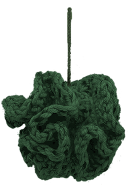
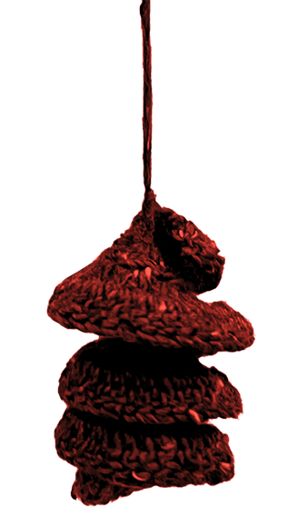

# Hyperbolic Crochet Making from Pseudo Code

Pick **one** of the two examples below and follow its pseudocode, stitch by stitch, to actually crochet the piece.

For instructions on specific crochet techniques referenced in the pseudocode (e.g. make_a_starting_slipknot()), watch the videos on moodle:
[Crochet instructional videos](https://www.moodle.tum.de/mod/page/view.php?id=4033750)


---

## Example 1: Pseudosphere



```
PROCEDURE CrochetPseudosphere(base_chain_stitch_count=4, first_round_stitch_count=12, rounds=5, increase=3)

    // 1. Start and make a base line
    current_layer = 0
    CALL make_a_starting_slipknot() // go to video for instructions

    FOR index = 1 TO base_chain_stitch_count
        CALL make_a_chain_stitch() // go to video for instructions
    END FOR

    // 2. Join to the first stitch to make a ring
    CALL make_a_slipstitch_to_first_chain()  // go to video for instructions

    // 3. Make double crochets into the ring center
    current_stitches_in_round = 0
    FOR i = 1 TO first_round_stitch_count
        CALL double_crochet_into_the_ring_center()
        current_stitches_in_round = current_stitches_in_round + 1
    END FOR
    current_layer = current_layer + 1

    // 4. Hyperbolic expansion in spiral: Make "increase" times double crochet to each stitch
    FOR r = 1 TO rounds
        FOR s = 1 TO current_stitches_in_round
            FOR k = 1 TO increase
                CALL double_crochet_to_stitch() // go to video for instructions
            END FOR
        END FOR
        current_stitches_in_round = current_stitches_in_round * increase
        current_layer = current_layer + 1
    END FOR

    CALL finish_pattern() // go to video for instructions 

END PROCEDURE
```

---

## Example 2: Hyperbolic Surface 



```
PROCEDURE CrochetHyperbolicSurface(base_chain_stitch_count=16, rows=3, increase=2)

    // 1. Start and make base line
    current_layer = 0
    CALL make_a_starting_slipknot() // go to video for instructions

    current_stitches_in_line = 0
    FOR i = 1 TO base_chain_stitch_count
        CALL make_a_chain_stitch() // go to video for instructions
        current_stitches_in_line = current_stitches_in_line +1
    END FOR

    // 2. Hyperbolic expansion in rows: Make "increase" times double crochet to each stitch
    FOR r = 1 TO rows
        FOR s = 1 TO current_stitches_in_line
            FOR k = 1 TO increase
                CALL double_crochet_in_line()
            END FOR
        END FOR
        current_stitches_in_line = current_stitches_in_line * increase
        current_layer = current_layer + 1

        CALL turn_work() 
    END FOR

    CALL finish_pattern()// go to video for instructions
    
END PROCEDURE
```

### Grasshopper wind-spinner model

The Grasshopper component in `src/cdf/gh_wind_spinner_component.py` visualizes
Example 2 as a vertical-axis wind spinner. It follows the stitch-count rule exactly:
`base_chain_stitch_count` stitches in the base chain, followed by one row per
`rows`, with each row containing `increase` times as many stitches as the
previous row. The base chain is placed along a curved, Z-directed centerline;
the later rows are mapped to a tapered, ruffled helix around that centerline
and joined into one open mesh.

The lecture pseudocode specifies stitch counts and turning the work, but not a
3D projection. The helix turns and ruffle settings in the component are
geometric choices used to visualize those rows; they are not additional crochet
steps. Its `curve_amount` input controls the centerline's S-bend: `0` is
straight, and larger values create a more pronounced bend (up to `0.5`). The
component has outputs for the mesh surface, row curves, axis, and stitch-count
information. It checks pairs of non-adjacent mesh faces for intersections and
adds a Grasshopper runtime error if an intersection is found.

The integer `single_crochet` input controls the number of rows and uses
`stitch_width` as the single-crochet unit length. The resulting crochet-length
progression is `x`, `2x`, `3x`, `3x + 1x`, `3x + 2x`, `3x + 3x`, and so on,
where `x` is `stitch_width`. The component reports the per-row stitch lengths,
stitch-type combinations, and total row path lengths through its
`crochet_stitch_lengths`, `crochet_stitch_patterns`, and `row_path_lengths`
outputs; `double_crochet_length` and `triple_crochet_length` expose `2x` and
`3x`. The first entry in `row_path_lengths` is the base-chain axis length.

### Optional triangular crochet mode

Connect `m_ratio` to enable the cone mode and use one integer slider named
`single_crochet` (minimum and step size 1). This replaces the separate `rows`,
`single_crochet_length`, and `max_width` inputs. Its value determines the row
count; the crochet-length unit is `stitch_width`, and maximum width is
`single_crochet * stitch_width`. Each integer increase adds one visible
transverse seam and widens the cone by one `stitch_width` unit.

`m_ratio` must be in the range `0..1`. The
cone profile is used internally to shape the wind chime; no cone is sent to the
`surface` output in this mode. `wind_chime` is the visible, layered helical
mesh, and `spiral` is its outer helical path. `ripple` controls the radial
ruffling. `inner_diameter_ratio` controls how far the inner edge is from the
axis as a fraction of `max_width` (default `0.60`); increase it to make the
spiral sheet thinner. `row_curves` exposes the intermediate helical paths and
`axis` is the centerline:

The optional `base_point` input translates all geometry outputs together from
the world origin to the supplied Rhino point. Connect a Grasshopper Point
parameter referencing a Rhino point and move that point in Rhino to reposition
the generated geometry without changing its shape.

- `0`: inverted cone, widest at the bottom and tapering to the top.
- `0.5`: two cones joined at their widest bases in the middle, tapering to a
  tip at both ends.
- `1`: upright cone, tapering from a bottom tip to the widest top edge.

The wind chime uses the configured `turns`, `stitches_per_wave`, and `rows`,
with the ruffle adapted to the cone profile. Its visible mesh is a twisted
sheet extending from the centerline to the cone-shaped outer edge, similar to
the original wind-spinner form. The cone itself is only a shaping guide.
Crochet stitch spacing follows the spiral path length, repeating single,
double, and triple crochet lengths (`x`, `2x`, `3x`), with `x` taken from
`stitch_width`. The
`spiral_stitch_pattern` output reports the sequence along the spiral.
`stitch_seams` contains visible curves at stitch boundaries and the additional
single-crochet seams; `stitch_seam_labels` identifies them.
Leave `m_ratio` unwired to continue using the existing wind-spinner surface.

```text
PROCEDURE MakeWindSpinner(base_chain_count, rows, increase)
    stitch_counts = [base_chain_count]
    REPEAT rows times
        APPEND last(stitch_counts) * increase
    END REPEAT

    centerline_height = base_chain_count * stitch_height
    DEFINE an S-shaped centerline from curve_amount
    SET row_profiles = [centerline]

    FOR each expanded row
        stitch_count = count for this row
        stitch_length = next value in
            [x, 2x, 3x, 3x+1x, 3x+2x, 3x+3x, ...]
        target_length = (stitch_count - 1) * stitch_length
        waves = round(stitch_count / stitches_per_wave)
        USE binary search to find a helix radius whose path length
            is approximately target_length
        APPEND this row's radius, wave count, and twist phase to row_profiles
    END FOR

    SAMPLE the centerline and each helical row at many positions
    CONNECT corresponding samples of adjacent rows with mesh faces

    FOR each pair of mesh faces that do not share vertices
        IF their bounding boxes overlap
            IF Rhino reports an intersection longer than tolerance
                REPORT a Grasshopper error and the intersecting face indices
                STOP checking
            END IF
        END IF
    END FOR

    RETURN the mesh, row curves, centerline, and stitch-count information
END PROCEDURE

PROCEDURE MakeTriangularCrochetSurface(single_crochet, m_ratio)
    max_width = single_crochet * stitch_width
    repeat single, double, triple crochet lengths x, 2x, 3x
    use the repeating lengths for stitch spacing along width and height
    blend between inverted and upright triangular width profiles using m_ratio
    at m_ratio = 0.5, join both profiles and twist by the configured turns
    RETURN the mesh, course curves, axis, and stitch-pattern information
END PROCEDURE
```
